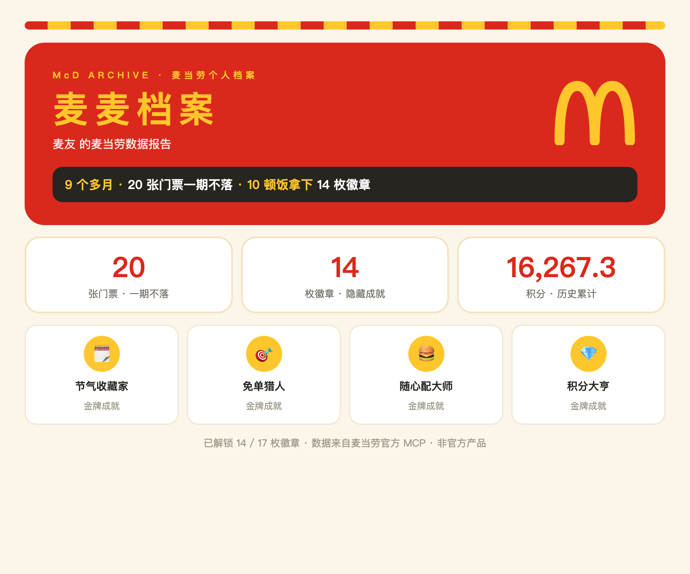
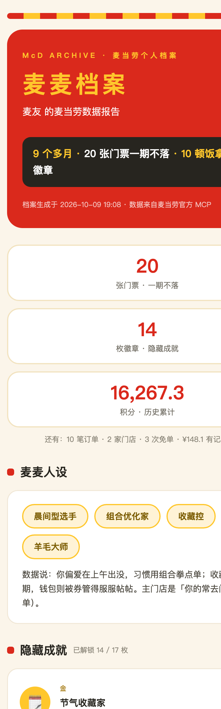

<div align="center">

# 麦麦档案 · mcd-archive

### 一句话，把你和麦当劳之间的所有数据，变成一份可以截图分享的个人档案

**「生成我的麦麦档案」** —— 订单、活动门票、积分、优惠券、隐藏成就，全部由**麦当劳官方 MCP** 真实数据驱动。

[](https://github.com/M-China-Official/mcd-developer-innovation-challenge/issues/95)
[](https://open.mcd.cn/mcp)
[]()
[]()
[](LICENSE)



**⭐ 觉得有意思？点一个 Star，就是给参赛作品最直接的投票**（大赛按 GitHub Star 排名）

*1024 程序员节 · 麦当劳程序员创意开发大赛参赛作品（已通过官方报名审核）· 非麦当劳官方产品*

</div>

---

## 眼见为实

完整档案在手机里长这样——封面、数据总览、麦麦人设、成就勋章墙，一屏一屏看：

<div align="center">

</div>

想亲手把玩：[下载完整档案 Demo](examples/report-demo.html)（单文件 HTML，浏览器打开即看，无需任何依赖）

## 这是什么

**麦麦档案（mcd-archive）** 是一个基于麦当劳官方 MCP 的个人数据报告 Skill，也是一套零依赖的 Python 工具链。

对 AI 助手说一句「生成我的麦麦档案」，它会读取你的麦当劳账户数据（订单、积分、券、活动门票、抽奖记录），生成一份**海报级、可截图分享**的 HTML 档案：数据总览、麦麦人设、隐藏成就勋章墙、门票收藏线、积分资产体检。

> 灵感：如果音乐 App 有年度报告，那你在麦当劳的这几个月，也值得一份档案。

## 档案里有什么

| 模块 | 内容 |
|---|---|
| 📊 数字一览 | 订单数 / 门店数 / 消费总额 / 免单次数 |
| 🎭 麦麦人设 | 由点餐时间、口味、价格习惯推导的个性标签 |
| 🏅 隐藏成就 | **17 条成就规则**，金/银/铜三级勋章 + 待解锁牵引 |
| 🗓 数字收藏馆 | 活动门票收藏线（节气系列，一期不落） |
| 💎 资产体检 | 积分资产 / 抽奖弹药 / 券包 / 兑换里程碑进度 |

**效果预览**：
- 分享卡：见上方主图（`assets/card.png`，另附矢量版 `assets/card.svg`）
- 完整档案示例：下载 [`examples/report-demo.html`](examples/report-demo.html) 用浏览器打开

## 快速开始

```bash
# 1. 申请麦当劳 MCP Token：打开 https://open.mcd.cn/mcp
#    手机号登录 → 控制台 → 激活 → 复制 Token
# 2. 配置 MCP 连接（见 mcp-config.example.json，把 ${MCD_TOKEN} 替换为你的 Token）
# 3. 运行（零第三方依赖，Python 3.9+）

cd scripts
python3 collect.py                          # 采集账户数据 → data/raw/
python3 analyze.py                          # 分析生成派生指标 → profile.json
python3 render.py --name 你的昵称            # 生成完整档案 report.html
python3 render.py --mode card               # 生成分享卡 report_card.html
```

> Token 读取优先级：环境变量 `MCD_TOKEN` → macOS 钥匙串 → 本地文件。脚本不会以任何形式上传你的数据。

## 安装为 Skill

本目录同时是一个标准 WorkBuddy / Claude Skill：

- Skill 定义见 [`SKILL.md`](SKILL.md)
- 放入 WorkBuddy 技能目录即可用自然语言触发（如「生成我的麦麦档案」）

## 作为 MCP Server 使用

本仓库还提供 **mcd-profile** MCP Server（[`mcp-server/`](mcp-server/)）：把档案能力以标准 MCP 工具暴露给任何客户端（Claude Desktop / WorkBuddy / Cherry Studio 等）。

| 工具 | 说明 |
|---|---|
| `get_profile_summary` | 档案摘要：订单 / 门店 / 积分 / 门票 / 券 / 奖品总览 |
| `get_tickets` | 节气门票收藏线 |
| `get_achievements` | 成就徽章（17 条规则，已解锁 + 待解锁） |
| `get_points_status` | 积分资产体检 |

```bash
pip install -r mcp-server/requirements.txt
MCD_TOKEN=<你的 Token> python3 mcp-server/server.py
```

配置示例与详细说明见 [`mcp-server/README.md`](mcp-server/README.md)。

## 调用的麦当劳 MCP 能力

订单历史、积分账户、积分抽奖、奖品记录、优惠券、麦麦省、活动日历、积分商城商品、营养数据等，均为**只读接口**。

完整的 Tool 清单、调用流程与业务价值说明见 👉 [`MCP_INTEGRATION.md`](MCP_INTEGRATION.md)

## 目标用户

- 好奇「我在麦当劳是什么人」的麦门玩家
- 喜欢年度报告、数据可视化、截图分享的玩家
- 想盘点积分/券/收藏的实用派
- 所有想知道「我的数据长什么样」的麦当劳用户

## FAQ

**Q：会消耗积分或产生订单吗？**
A：不会。仅使用只读接口，不扣分、不下单、不领券。

**Q：数据太少怎么办？**
A：内置「轻档案」降级模式——从第一顿饭开始就能生成，数据越攒越丰富。

**Q：我的数据安全吗？**
A：所有数据仅在你本地处理；仓库中的示例数据已做脱敏处理，不含账号标识信息。

## 支持一下

如果这份档案让你好奇自己的数据长什么样——欢迎点一个 ⭐ **Star**，或分享给同样爱吃麦当劳的朋友。这是麦当劳程序员创意开发大赛的参赛作品，每个 Star 都是最直接的投票。

## 声明

- 本项目为参赛作品，由参赛者独立开发，**非麦当劳官方产品**
- 数据、餐品、价格及供应状态以麦当劳官方渠道的实时结果为准
- [MIT License](LICENSE)
